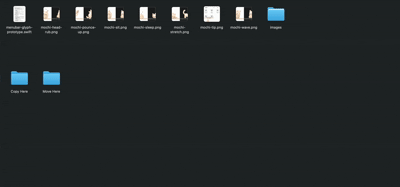

<p align="center">
  
</p>

<h1 align="center">DragShelf</h1>

<p align="center">
  <b>A floating shelf for drag and drop on macOS.</b><br>
  Start dragging anything and the shelf slides in. Drop your files on it, switch apps at your own pace, then drag them out where they need to go.
</p>

<p align="center">
  <a href="https://github.com/ydvabhee/dragshelf/releases/latest"></a>
  
  
  
</p>

<p align="center">
  <a href="https://github.com/ydvabhee/dragshelf/releases/latest"><b>Download</b></a> ·
  <a href="#features">Features</a> ·
  <a href="#meet-mochi">Meet Mochi</a> ·
  <a href="#install">Install</a> ·
  <a href="CHANGELOG.md">Changelog</a>
</p>

<p align="center"></p>

---

## Why

Dragging a file into an app that's hidden or behind other windows is painful. You hold the file, switch apps, wait for the window to come forward, and halfway there the drag drops and the file snaps back.

DragShelf removes the rush. The shelf holds your files for as long as you need, stays above every window, and never steals focus from the app you're working in.

## Features

<table>
<tr>
<td width="50%" valign="top">

### The shelf
- **Appears when you drag** anything: files, folders, images, links, text, Mail and Photos attachments
- **Drag out to copy, hold ⌘ to move**, just like Finder
- **Paste with ⌘V**, or "Paste to DragShelf" from the menu bar
- **Text to .txt and back**: text drops as text into apps and as a `.txt` file into Finder
- **Movable and resizable**, remembered per display

</td>
<td width="50%" valign="top">

### Actions
- **Compress** items into a zip
- **Convert** images to HEIC, JPEG, PNG or TIFF
- **Resize** to presets or a custom size (pixels or percent)
- **Rename** the shelf's copy (originals are never touched)
- **Share and AirDrop** from the Actions menu

</td>
</tr>
<tr>
<td width="50%" valign="top">

### Organize
- **Pin** items you use often; they survive Clear and restarts
- **Search** with ⌘F and **filter** by Files, Folders, Images, Links, Text or Pinned
- **Recent**: your last 5 drag-outs, with **⌘Z** to undo
- **Quick Look** with Space, multi-select with ⌘ and ⇧

</td>
<td width="50%" valign="top">

### Native and light
- **Liquid Glass** on macOS 26, vibrancy on macOS 14–15
- **Your own global shortcut** (default ⌃⌥⌘D)
- **Light and dark**, Reduce Motion, VoiceOver, keyboard access
- **About 0% CPU and 20 MB** when idle, no item limit
- **No permission prompts**, no third-party code

</td>
</tr>
</table>

## Meet Mochi

Mochi is an optional shelf pet: a soft clay cat that lives on the bottom rim of DragShelf.

- **Has a personality.** Curious, Playful, Lazy, Shy or Mischievous. Mochi naps a lot, wanders over to sniff and bat at your items, and sometimes brings its own ball to play with.
- **Notices you, on its own terms.** Move your cursor over the shelf and Mochi may watch, stroll over, pounce or ignore you. Linger near its head for a purr. Double-click the shelf to call it.
- **Teaches you DragShelf.** Tips come from Mochi in a small speech bubble, one at a time, never during a drag.
- **Never gets in the way.** It runs off the shelf while you drag, never touches your items, and costs almost nothing while asleep.

Mochi is off by default. New users get a short preview, then DragShelf asks once whether to keep it. Turn it on any time in **Settings → Pet**, and right-click Mochi to send it home.

## Install

### Download

Get **`DragShelf.dmg`** from the **[Releases page](https://github.com/ydvabhee/dragshelf/releases/latest)** (under **Assets**).

1. Open the DMG and drag **DragShelf** into **Applications**.
2. Preview builds aren't notarized yet, so macOS blocks the first launch:
   - **macOS 15 or later:** try to open it once, then go to **System Settings → Privacy & Security** and click **Open Anyway**.
   - **macOS 14:** right-click DragShelf in Applications, choose **Open**, then **Open** again.
3. DragShelf lives in the menu bar and has no Dock icon. Turn on **Launch at login** in Settings to keep it running.

### Build from source

```sh
git clone https://github.com/ydvabhee/dragshelf.git
cd dragshelf
scripts/build-app.sh release
open build/DragShelf.app
```

A locally built app isn't quarantined, so there's no Gatekeeper prompt.

**Requirements:** macOS 14 or later (Liquid Glass needs macOS 26). Building needs Xcode 26 or later (Swift 6.2).

## Usage

| Action | How |
|---|---|
| Show DragShelf | Start dragging anything, press your shortcut (default **⌃⌥⌘D**), or **Show DragShelf** in the menu bar |
| Add items | Drop them on the shelf, or press **⌘V** |
| Copy out / move out | Drag an item to any app or folder; hold **⌘** to move a file |
| Actions | Select items, then the **⋯** menu or right-click: Compress, Rename, Share, AirDrop, Convert To, Resize |
| Pin | Right-click → **Pin** |
| Search | **⌘F** or the magnifying glass; filter from the menu next to it |
| Undo a drag-out | **⌘Z**, or the clock button for your last 5 |
| Preview | Select and press **Space** |
| Remove / clear | Hover ✕, **Delete**, or **Clear** (pinned items stay) |
| Move / resize | Drag the header / drag the edges; double-click the header to reset |
| Hide | **Esc**, the close button, or your shortcut |

Unpinned items leave the shelf once they're dragged out, and the shelf empties when you quit.

## Settings

Open **Settings…** from the menu bar icon.

- **General:** launch at login, show DragShelf when dragging, global shortcut (record your own)
- **DragShelf:** keep items after drag out, reset position
- **Tips:** show tips, reset tips
- **Pet:** show Mochi, personality, name, preview
- **More Apps:** show other apps from the developer

## Privacy

- DragShelf never reads your files' contents. It keeps references, and its own temporary copies (dropped images, file promises, action results) live in `~/Library/Caches/com.abhishekyadav.DragShelf`, cleaned while running and wiped on launch and quit.
- **Pinned** items are stored in `~/Library/Application Support/com.abhishekyadav.DragShelf/Pinned/`: originals by bookmark, plus copies of items that only exist on the shelf.
- **Network:** one request, once a day: a small public JSON list of other apps by the same developer, shown as one dismissible line. It's a plain HTTPS GET with no identifiers, cookies or analytics; links open only for allowlisted `https` domains. Turn it off in Settings to stop all network access. The format is in [`backend/promos.schema.json`](backend/promos.schema.json).

## Build and test

```sh
swift build                     # debug build
swift test                      # unit tests (Swift Testing)
scripts/build-app.sh            # debug .app → build/DragShelf.app
scripts/build-app.sh release    # optimized .app, ad-hoc signed
scripts/make-dmg.sh             # release .app packaged as build/DragShelf.dmg
scripts/make-icon.sh            # regenerate the app icon
```

The version lives in [`VERSION`](VERSION) ([Semantic Versioning](https://semver.org/)); the build number is the git commit count. To work in Xcode, open `Package.swift`. Warnings are errors, with Swift 6 strict concurrency and the main actor as default isolation.

<details>
<summary><b>Project structure</b></summary>

```
Sources/DragShelf/
  App/      app entry, menu bar, settings, global shortcut, preferences
  Actions/  compress, convert/resize, rename; the action runner
  Model/    shelf items, store (ordered items + O(1) dedupe), cache, pins, tips
  Panel/    floating non-activating panel, drag detection, drop in, drag out
  Pet/      Mochi: art drawn in code, behavior engine, controller
  Promos/   remote "more apps" feed: strict decoding, allowlist, loader
  UI/       SwiftUI views, Liquid Glass styling, search, forms, share, thumbnails
Tests/DragShelfTests/   unit tests
backend/                example promo feed and its JSON schema
docs/                   product spec, architecture and ADRs, tasks, QA plan, release checklist
scripts/                build, DMG and icon scripts
```

Design decisions are recorded as ADRs in [`docs/ARCHITECTURE.md`](docs/ARCHITECTURE.md); the product spec is in [`docs/PRD.md`](docs/PRD.md).

</details>

## Roadmap

- **Signed and notarized** builds (Developer ID)
- **More pets:** a penguin, a baby dino and a bee, with a pet picker
- See [`docs/TASKS.md`](docs/TASKS.md) for the full plan

## Contributing

Issues and pull requests are welcome.

1. Keep it native: AppKit and SwiftUI, with **no third-party dependencies** unless an ADR justifies one.
2. `swift build`, `swift test` and `scripts/build-app.sh release` must pass with zero warnings.
3. Add a unit test for new logic.
4. Use [Conventional Commits](https://www.conventionalcommits.org/) (`feat: …`, `fix: …`, `docs: …`).
5. Add a line under `## [Unreleased]` in [`CHANGELOG.md`](CHANGELOG.md) for every user-visible change.
6. Follow Apple's Human Interface Guidelines and keep VoiceOver, keyboard access and Reduce Motion working.

## License

No license has been chosen yet. Until a `LICENSE` file is added, all rights are reserved by the author.

---

<p align="center">Made by <a href="https://github.com/ydvabhee">Abhishek Yadav</a></p>
